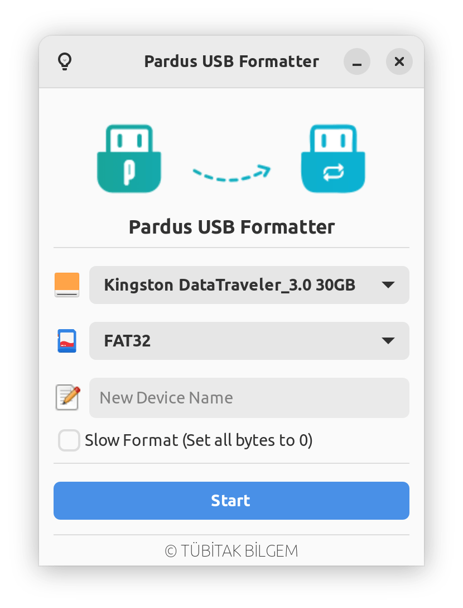
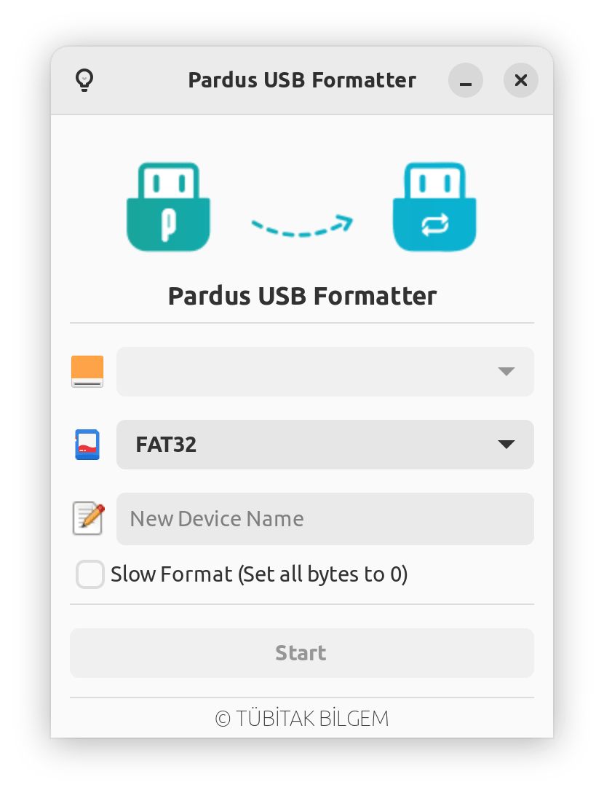

# ParsLinux Formatter 💾

<div align="center">


**GNU/Linux sistemler için yüksek performanslı, güvenli ve çoklu arayüzlü USB disk biçimlendirici.**

[](https://www.gnu.org/licenses/gpl-3.0)
[](https://www.python.org/)
[](https://www.gtk.org/)
[](https://gnome.pages.gitlab.gnome.org/libadwaita/)
[](https://kernel.org)

[Özellikler](#-öne-çıkan-özellikler) • [Ekran Görüntüleri](#-ekran-görüntüleri) • [Hızlı Başlangıç](#-hızlı-başlangıç) • [Komut Satırı (CLI)](#-komut-satırı-cli-kullanımı) • [Mimari & Güvenlik](#-mimari-ve-güvenlik) • [Dokümantasyon](#-dokümantasyon-rehberleri)

</div>

---

## 📖 Genel Bakış

**ParsLinux Formatter**, USB bellekleri ve harici depolama aygıtlarını en yaygın dosya sistemleriyle (FAT32, NTFS, exFAT, EXT4, BTRFS, XFS, F2FS) hızlı, kolay ve mutlak sistem güvenliği ile biçimlendirmek için geliştirilmiş bağımsız bir sistem aracıdır.

Modern **GTK4 / Libadwaita** arayüzü, hafif **GTK3** klasik arayüzü ve grafik sunucusuna ihtiyaç duymadan çalışan bağımsız **CLI** motoru olmak üzere üç farklı çalışma kipi sunar.

### ✨ Öne Çıkan Özellikler

- 🚀 **Evrensel Dosya Sistemi Desteği:**
  - `FAT32` (dosfstools) — Tüm işletim sistemleri ve TV/Oto teypleriyle evrensel uyumluluk.
  - `NTFS` (ntfs-3g) — Büyük boyutlu dosyalar ve Windows ortamları için.
  - `exFAT` (exfatprogs) — Modern USB 3.0+ flash bellekler ve SDXC kartlar için.
  - `EXT4` (e2fsprogs) — Standart Linux günlüklemeli (journaling) dosya sistemi.
  - `BTRFS` — Yeni nesil anlık görüntü (snapshot) ve sıkıştırma destekli dosya sistemi.
  - `XFS` — Büyük dosyalar ve yüksek I/O iş yükleri için yüksek verimli dosya sistemi.
  - `F2FS` — Flash belleklerin ve SSD'lerin ömrünü uzatan özel Flash-Friendly dosya sistemi.
- 🛡️ **5 Kademeli Çekirdek Güvenlik Kalkanı:**
  - Kök (`/`), `/boot`, `/home`, swap, EFI ve dahili NVMe/SATA ana sistem disklerinin yanlışlıkla seçilmesini çekirdek düzeyinde engeller.
- ⚡ **Yüksek Hızlı 4 MiB Tamponlu Sıfırlama (Zero-Fill):**
  - Eski 512 baytlık yavaş blok yazımı yerine 4 MiB dinamik bellek tamponuyla 100 kat hızlı tam silme motoru.
- 🧹 **Donanımsal TRIM / Hızlı Temizleme:**
  - Modern SSD ve USB flash bellekler için saniyeler süren `blkdiscard` temizliği.
- 🔒 **Modern LUKS2 Şifreleme:**
  - USB diski donanımsal olarak şifreleyerek çalınma ve kaybolmaya karşı tam veri koruması.
- ⏱️ **İşbirlikçi İptal Modeli:**
  - Veri kaybı veya dosya sistemi bozulması yaratmadan (fsync/sync korumasıyla) güvenli iptal.
- 🖥️ **Üçlü Kullanım Modu:**
  - `parslinux-formatter-gtk4` (Modern Libadwaita deneyimi)
  - `parslinux-formatter` (Klasik GTK3 / Glade arayüzü)
  - `parslinux-formatter-cli` (Renkli ANSI ve `--json` olay akışlı komut satırı)

---

## 🖼️ Ekran Görüntüleri

<div align="center">

| Modern GTK4 / Libadwaita Arayüzü | Klasik GTK3 Arayüzü |
|:---:|:---:|
|  |  |

</div>

---

## 🚀 Hızlı Başlangıç

### Sistem Bağımlılıkları (Debian / Ubuntu / ParsLinux):
```bash
sudo apt update
sudo apt install -y python3-gi gir1.2-gtk-3.0 gir1.2-gtk-4.0 gir1.2-adwaita-1 \
                    python3-pyudev dosfstools ntfs-3g exfatprogs e2fsprogs \
                    btrfs-progs xfsprogs f2fs-tools cryptsetup parted policykit-1
```

### Kaynak Koddan Çalıştırma:
```bash
# Modern GTK4 Arayüzü:
./parslinux-formatter-gtk4

# Bağımsız Komut Satırı Arayüzü:
./parslinux-formatter-cli --list
```

---

## 💻 Komut Satırı (CLI) Kullanımı

```bash
# USB diskleri listele
parslinux-formatter-cli --list

# Hızlı FAT32 biçimlendirme
parslinux-formatter-cli -d sdb -t FAT32 -l PARS_DISK -y

# ExFAT ve GPT biçimlendirme
parslinux-formatter-cli -d sdc -t EXFAT -l YEDEK --gpt -y

# Flash bellek için F2FS ve donanımsal TRIM
parslinux-formatter-cli -d sdb -t F2FS -l FLASH --trim -y

# Tam güvenli sıfırlama (Zero-Fill) ile EXT4
parslinux-formatter-cli -d sdb -t EXT4 -l TEMIZ --fill -y

# Etkileşimli sihirbaz modu
parslinux-formatter-cli -i
```

---

## 📚 Dokümantasyon Rehberleri

Proje hakkındaki tüm detaylar `docs/` klasöründe belgelenmiştir:

| Belge | Açıklama |
| :--- | :--- |
| [ARCHITECTURE.md](docs/ARCHITECTURE.md) | Dahili mimari, IPC, ayrıcalık ayrımı ve blok katmanı |
| [FORK.md](docs/FORK.md) | Çatallama beyannamesi, köken ve lisans uyumu |
| [CLI_REFERENCE.md](docs/CLI_REFERENCE.md) | Komut satırı parametreleri ve `--json` akış spesifikasyonu |
| [SECURITY.md](docs/SECURITY.md) | 5 kademeli güvenlik modeli ve Polkit yapılandırması |
| [TESTING.md](docs/TESTING.md) | Loop aygıtı ile sanal testler ve birim test kılavuzu |
| [INSTALL.md](docs/INSTALL.md) | Paket kurulumu, Debian derleme ve bağımlılıklar |
| [CHANGELOG.md](docs/CHANGELOG.md) | Sürüm geçmişi ve değişiklik kayıtları |
| [FLATPAK_PACKAGING.md](docs/FLATPAK_PACKAGING.md) | Flatpak manifestosu ve Flathub kılavuzu |
| [DATA_SAVING_GUIDE.md](docs/DATA_SAVING_GUIDE.md) | Veri güvenliği ve disk koruma yönergeleri |
| [progress.md](docs/progress.md) | Dinamik geliştirme ilerleme tablosu |

---

## 📜 Lisans

Bu proje **GNU General Public License v3.0 (GPL-3.0-or-later)** lisansı altında lisanslanmıştır. Ayrıntılar için `LICENSE` dosyasına bakınız.
